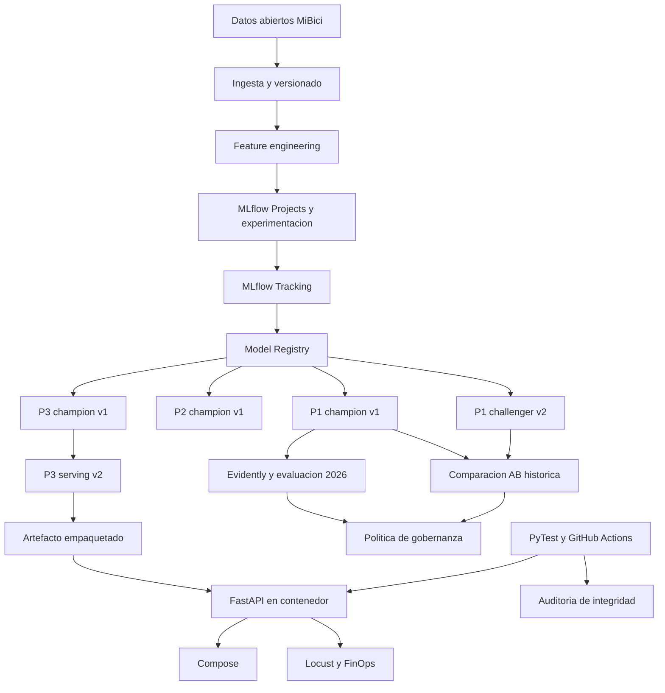
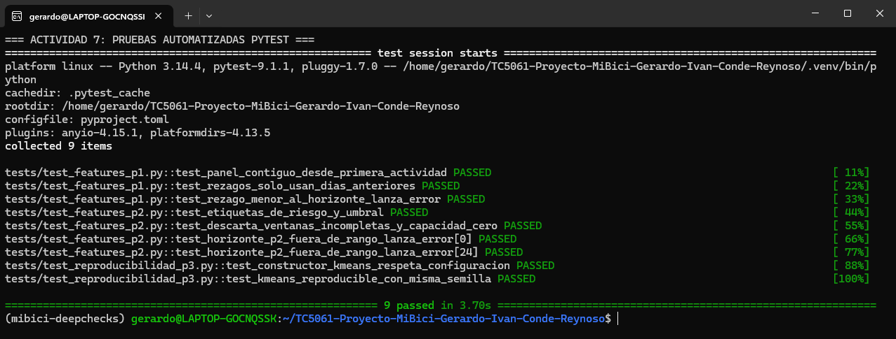
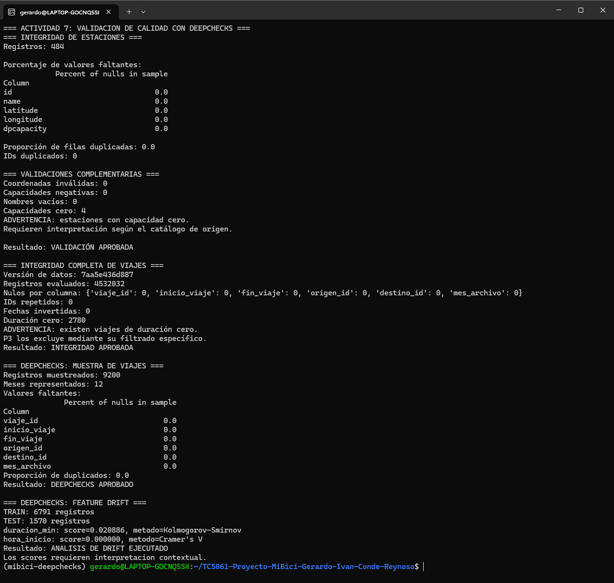
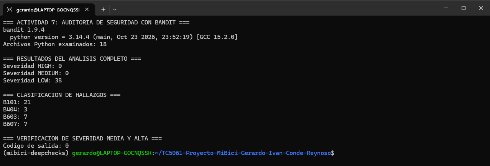
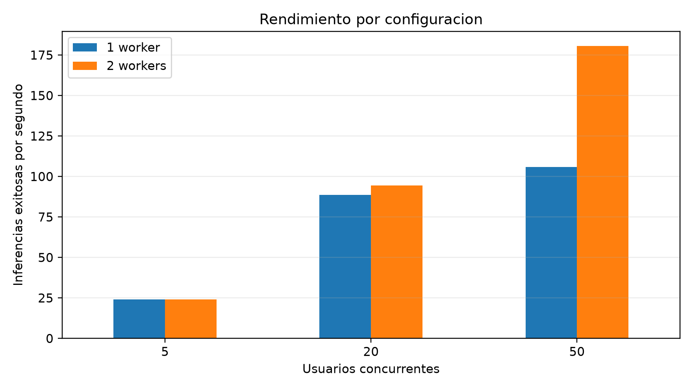
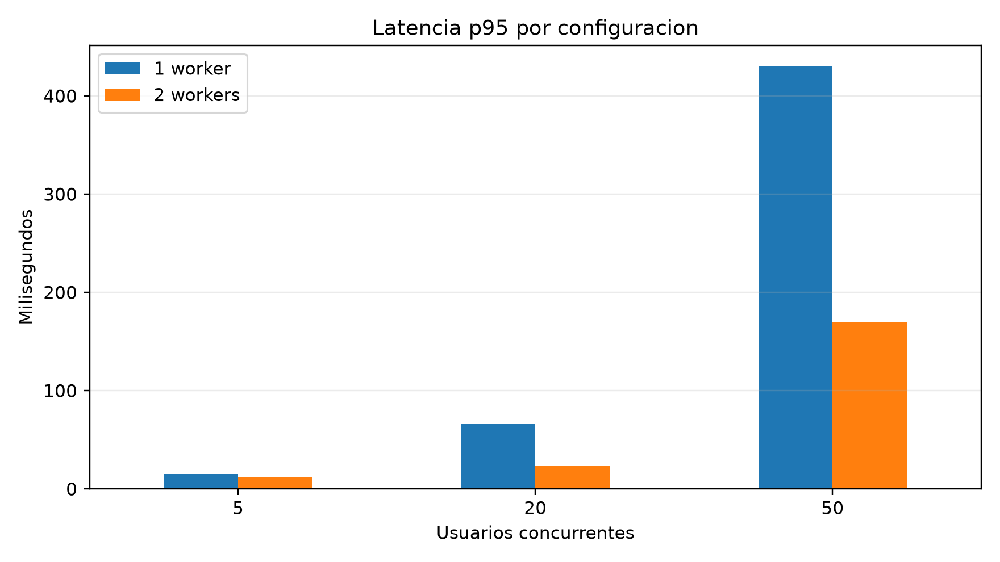

# TC5061 — Proyecto MiBici

[](https://github.com/GIvanConder/TC5061-Proyecto-MiBici-Gerardo-Ivan-Conde-Reynoso/actions/workflows/ci-cd.yml)

<!-- INICIO_GUIA_PROYECTO_FINAL -->

## Entrega final — Proyecto MiBici

**Actividad:** Construye | Entrega proyecto final | Colaborativo

**Curso:** Operaciones de Aprendizaje Automático (MLOps).

**Equipo:** 32.

**Programa:** Maestría en Inteligencia Artificial Aplicada,
Tecnológico de Monterrey.

### Resumen ejecutivo

El proyecto implementa un ciclo de vida de Machine Learning
aplicado al sistema de bicicletas públicas MiBici,
integrando preparación de datos, experimentación,
evaluación temporal, registro de modelos, despliegue,
pruebas, integración continua, monitoreo y gobernanza.

Se desarrollaron tres problemas complementarios:

| Problema | Objetivo | Modelo seleccionado |
|---|---|---|
| P1: Regresión | Estimar viajes iniciados por estación al día siguiente | PoissonRegressor |
| P2: Clasificación | Identificar riesgo indirecto de desequilibrio durante las próximas dos horas | HistGradientBoostingClassifier |
| P3: Clustering | Agrupar estaciones según sus patrones de uso | KMeans, k=4 |

P1 demuestra el proceso de monitoreo, comparación de versiones
y gobernanza. P3 demuestra el despliegue de un modelo mediante
una API REST, contenedores, microservicios y evaluación
de desempeño operacional.

### Resultados principales

| Problema | Métrica principal | Baseline TEST | Champion TEST |
|---|---|---:|---:|
| P1 | MAE | 7.219455 | 5.409786 |
| P2 | F1 | 0.364526 | 0.400710 |
| P2 | PR-AUC | 0.351402 | 0.399357 |
| P3 | ARI TRAIN-TEST | 0.725865 | 0.792685 |
| P3 | NMI TRAIN-TEST | 0.619183 | 0.736070 |

Las métricas corresponden a los protocolos temporales
originales de 2025.

P1 y P2 se seleccionaron mediante VALIDATION.
La selección de P3 se basó en métricas internas de TRAIN
y la utilidad interpretativa de la segmentación.

TEST se reservó para la evaluación final.

P3 no supera al baseline en todas las métricas internas;
la elección de cuatro grupos representa un compromiso
entre calidad, estabilidad e interpretabilidad.

Consultar las [Model Cards](docs/model_cards/README.md)
para revisar los resultados completos y sus limitaciones.

### Arquitectura integral



MLflow Tracking y Model Registry conservan el linaje de las
versiones seleccionadas.

El servicio de inferencia utiliza el pipeline P3 serving v2
empaquetado localmente. No consulta MLflow en cada petición.

El servicio MLflow incluido en Compose dispone de
almacenamiento independiente. No debe confundirse con
la base histórica de experimentación y Model Registry.

### Model Registry y versiones

| Modelo registrado | Versión | Alias | Función |
|---|---:|---|---|
| mibici-equipo32-p1-demanda | 1 | champion | Regresión seleccionada |
| mibici-equipo32-p1-demanda | 2 | challenger | Comparación histórica de versiones |
| mibici-equipo32-p2-riesgo | 1 | champion | Clasificación seleccionada |
| mibici-equipo32-p3-grupos | 1 | champion | KMeans seleccionado |
| mibici-equipo32-p3-grupos | 2 | serving | Pipeline completo para inferencia |

Versión histórica de datos: `7aa5e436d887`.

Versión de evaluación externa: `c915fc2638a4`.

P3 serving v2 conserva el KMeans original e incorpora
su preprocesamiento ajustado durante el entrenamiento.
Su creación no requirió un nuevo ajuste de KMeans.

El estado READY del Registry no implica que todos los
modelos estén expuestos mediante la API.

### Guía de evaluación por rúbrica

#### 1. Estructura y experimentación — 20 puntos

| Evidencia | Ubicación |
|---|---|
| Definición de MLflow Projects | [MLproject](MLproject) |
| Entorno reproducible | [python_env.yaml](python_env.yaml) |
| Dependencias | [requirements.txt](requirements.txt) |
| Configuración | [mibici/config.py](mibici/config.py) |
| Ingesta y transformación | [mibici/dataset.py](mibici/dataset.py) |
| Feature engineering | [mibici/features.py](mibici/features.py) |
| Entrenamiento de P1 | [p1_regresion.py](mibici/modeling/p1_regresion.py) |
| Entrenamiento de P2 | [p2_clasificacion.py](mibici/modeling/p2_clasificacion.py) |
| Entrenamiento de P3 | [p3_clustering.py](mibici/modeling/p3_clustering.py) |

#### 2. Modelo registrado y linaje — 15 puntos

| Evidencia | Ubicación |
|---|---|
| Registro y gestión de modelos | [model_registry.py](mibici/model_registry.py) |
| Model Cards | [docs/model_cards](docs/model_cards/README.md) |
| Metadatos de serving v2 | [deployment_metadata.json](serving/models/p3/deployment_metadata.json) |
| Equivalencia del pipeline | [validacion_pipeline_p3.json](docs/evidencias/api-p3/validacion_pipeline_p3.json) |
| Validación API y Registry | [validacion_api_registry_v2.json](docs/evidencias/api-p3/validacion_api_registry_v2.json) |

#### 3. Despliegue y operación — 25 puntos

| Evidencia | Ubicación |
|---|---|
| Contenedor de inferencia | [Containerfile](serving/Containerfile) |
| Arquitectura de microservicios | [docker-compose.yml](docker-compose.yml) |
| Variables de entorno | [.env.example](.env.example) |
| Validación Compose | [README_compose.md](docs/evidencias/operacion_finops/README_compose.md) |
| Integración continua | [GitHub Actions](.github/workflows/ci-cd.yml) |
| Documentación CI/CD | [README_ci_cd.md](docs/evidencias/operacion_finops/README_ci_cd.md) |
| Pruebas de carga | [Locustfile](load_testing/locustfile.py) |
| Resultados operacionales | [Locust y FinOps](docs/evidencias/operacion_finops/README_locust_finops.md) |
| Pruebas automatizadas | [tests](tests/) |
| Integridad de artefactos | [verificar_integridad_ci.py](scripts/verificar_integridad_ci.py) |

#### 4. Monitoreo, gobernanza y FinOps — 20 puntos

| Evidencia | Ubicación |
|---|---|
| Monitoreo histórico P1 | [Evidently 2025](docs/evidencias/monitoreo_p1/README.md) |
| Comparación A/B histórica | [A/B testing](docs/evidencias/ab_p1/README.md) |
| Resultados pareados | [comparacion_ab_p1.json](docs/evidencias/ab_p1/comparacion_ab_p1.json) |
| Evaluación externa 2026 | [Monitoreo final](docs/evidencias/monitoreo_final/README.md) |
| Reporte Evidently 2026 | [Reporte HTML](docs/evidencias/monitoreo_final/evidently_p1_2026.html) |
| Drift por variable | [Resumen CSV](docs/evidencias/monitoreo_final/resumen_drift_variables_2026.csv) |
| Desempeño mensual | [Desempeño 2026](docs/evidencias/monitoreo_final/desempeno_mensual_2026.csv) |
| Política de Continuous Training | [Gobernanza P1](monitoring/README_politica_ct_p1.md) |
| Resultado de la política | [resultado_politica_ct_2026.json](docs/evidencias/monitoreo_final/resultado_politica_ct_2026.json) |
| Model Card P1 | [Predicción de demanda](docs/model_cards/P1_demanda.md) |
| Model Card P2 | [Clasificación de riesgo](docs/model_cards/P2_riesgo.md) |
| Model Card P3 | [Segmentación de estaciones](docs/model_cards/P3_segmentacion.md) |
| Escenarios de costos | [FinOps](docs/evidencias/operacion_finops/finops/escenarios_finops.csv) |
| Auditoría experimental | [Reproducibilidad](docs/evidencias/operacion_finops/auditoria_reproducibilidad.json) |

Los reportes HTML pueden descargarse desde GitHub
y abrirse localmente en un navegador.

#### 5. Presentación y demostración — 20 puntos

La presentación y el video continuo de demostración
se entregan mediante Canvas.

La demostración se apoya en la API P3, sus endpoints
de salud e inferencia y las evidencias versionadas
de experimentación, operación y gobernanza.

### Monitoreo y decisión de mantenimiento

La comparación A/B histórica utiliza 22,565 observaciones
comunes de noviembre y diciembre de 2025.

| Indicador | Resultado |
|---|---:|
| MAE champion v1 | 5.409786 |
| MAE challenger v2 | 5.475699 |
| Diferencia champion menos challenger | -0.065913 |
| Límite inferior IC95% | -0.113995 |
| Límite superior IC95% | -0.020573 |

La comparación pareada y el bootstrap por bloques
de siete días respaldan la conservación del champion v1.

No se trata de un experimento aleatorizado en producción.

La evaluación externa de enero a octubre de 2026
comprende 3,840,981 viajes utilizables, 304 días
y 122,365 observaciones estación-día.

| Indicador externo P1 | Resultado |
|---|---:|
| Estaciones evaluadas | 472 |
| MAE champion | 6.068723 |
| MAE baseline | 7.758607 |
| WAPE | 19.4508% |
| Incremento de MAE respecto a TEST 2025 | 12.18% |
| Reducción de MAE respecto al baseline externo | 21.78% |
| Variables con drift | 4 de 12 |

El modelo conserva utilidad predictiva frente al baseline
semanal durante los diez meses, aunque se identifica
deterioro respecto al TEST histórico.

La política inicial establece una alerta de desempeño
cuando el MAE aumenta al menos 15% respecto a la referencia.
Dos meses consecutivos de deterioro justifican solicitar
la evaluación de un posible reentrenamiento.

La aplicación retrospectiva activa esta recomendación
en octubre de 2026.

Los umbrales requieren validación prospectiva.
No se realizaron nuevos entrenamientos ni promociones
durante la consolidación final.

### Desempeño operacional y FinOps

Las pruebas de carga de P3 se ejecutaron localmente
con perfiles sintéticos y dos configuraciones de workers.

| Usuarios concurrentes | Workers | RPS exitosas | Latencia p95 |
|---:|---:|---:|---:|
| 5 | 1 | 24.13 | 15 ms |
| 20 | 1 | 88.75 | 66 ms |
| 50 | 1 | 105.79 | 430 ms |
| 5 | 2 | 24.11 | 12 ms |
| 20 | 2 | 94.47 | 23 ms |
| 50 | 2 | 180.56 | 170 ms |

Se registraron 90,239 peticiones exitosas y cero fallos
en los seis escenarios principales de carga.

El SLO exploratorio de latencia p95 de hasta 200 ms
permite contrastar las configuraciones estudiadas.
Fue definido después de obtener las mediciones y no
constituye un SLA de producción.

Se conserva un worker como configuración base,
con la posibilidad de utilizar dos workers cuando
la demanda y los recursos disponibles lo justifiquen.

Las estimaciones FinOps utilizan escenarios de referencia
de Amazon Lightsail con precios mensuales de USD 42
para 2 vCPU y 4 GB, y USD 84 para 4 vCPU y 8 GB.

| Escenario de referencia | Costo mensual | Costo estimado por millón de inferencias |
|---|---:|---:|
| 1 worker, 20 usuarios, 2 vCPU | USD 42 | USD 0.365 |
| 2 workers, 20 usuarios, 2 vCPU | USD 42 | USD 0.343 |
| 2 workers, 50 usuarios, 4 vCPU | USD 84 | USD 0.359 |

Los costos unitarios suponen una utilización del 50%
del rendimiento exitoso observado y un mes de 30 días.

La utilización representa una fracción del throughput,
no el porcentaje de CPU.

Son escenarios económicos hipotéticos basados en
mediciones locales. No representan facturación real
ni validación de rendimiento sobre instancias en nube.

No incluyen impuestos, personal, alta disponibilidad,
entrenamiento, respaldos ni otros servicios adicionales.

Consultar las [mediciones consolidadas](docs/evidencias/operacion_finops/finops/mediciones_consolidadas.csv)
y los [escenarios FinOps](docs/evidencias/operacion_finops/finops/escenarios_finops.csv).

### Guía rápida de demostración

La demostración de P3 no requiere reentrenar modelos,
descargar los datos crudos ni recuperar el Registry
histórico de experimentación.

Se requiere Git y un entorno compatible con Docker
Compose o Podman Compose.

Desde la raíz del repositorio, con Podman Compose
previamente configurado:

```bash
podman compose up -d --build
podman compose ps
```

Alternativamente, con Docker:

```bash
docker compose up -d --build
docker compose ps
```

Utilizar solamente una de las alternativas.

Una vez que los servicios estén saludables:

```bash
curl --fail --silent --show-error http://127.0.0.1:8000/health
```

La respuesta debe identificar el modelo
`mibici-equipo32-p3-grupos`, versión 2.

La documentación interactiva está disponible en:

`http://127.0.0.1:8000/docs`

Ejemplo de inferencia:

```bash
curl --fail --silent --show-error \
  -X POST http://127.0.0.1:8000/predict \
  -H 'Content-Type: application/json' \
  -d '{
    "salidas_dia": 20.0,
    "llegadas_dia": 19.0,
    "balance_relativo": -0.02564102564102564,
    "share_fin_semana": 0.25,
    "salida_manana_share": 0.25,
    "llegada_manana_share": 0.25,
    "salida_mediodia_share": 0.25,
    "llegada_mediodia_share": 0.25,
    "salida_tarde_share": 0.25,
    "llegada_tarde_share": 0.25,
    "salida_noche_share": 0.25,
    "llegada_noche_share": 0.25
  }'
```

La respuesta incluye un identificador de clúster y
la versión del modelo utilizado.

El procedimiento detallado de instalación y operación
se conserva en las secciones técnicas del README
y en la documentación de Compose.

### Reproducibilidad y alcance

El proyecto conserva instrucciones para reproducir
los experimentos originales mediante MLflow Projects,
las pruebas automatizadas y los análisis de evidencias.

Los CSV originales, Parquet intermedios, base SQLite
histórica y artefactos locales de experimentación
se excluyen del control de versiones.

La reproducción completa de los experimentos requiere
recuperar los datos y preparar los entornos descritos
en la documentación técnica.

Las evidencias agregadas de monitoreo y FinOps permiten
inspeccionar los resultados sin repetir el entrenamiento.

Con el entorno Python del proyecto preparado:

```bash
./.venv/bin/python -m pytest -q
./.venv/bin/python scripts/verificar_integridad_ci.py
```

La última consolidación local del monitoreo y Model Cards
verificó 90 pruebas automatizadas y la integridad de
los ocho archivos del artefacto de serving P3.

### Limitaciones generales

- P1 estima demanda observada, no inventario físico.
- P2 utiliza una etiqueta indirecta basada en flujo neto.
- P3 presenta solapamiento entre grupos y sus etiquetas
  no representan un orden de riesgo.
- El catálogo de estaciones no reconstruye capacidades
  históricas vigentes para cada fecha.
- La evaluación externa de 2026 corresponde únicamente
  al champion P1.
- El monitoreo retrospectivo no equivale a un sistema
  de observabilidad en tiempo real.
- Las pruebas de carga locales no garantizan capacidad
  equivalente en otros entornos.
- La política de Continuous Training genera recomendaciones;
  no ejecuta reentrenamientos ni promociones automáticas.

### Fuente de datos

[Datos abiertos de MiBici](https://mibici.net/es/datos-abiertos/).

La documentación técnica original y las instrucciones
de las actividades anteriores se conservan a continuación.

Los resultados de esas secciones corresponden a sus
respectivas etapas históricas. Para el estado consolidado
del proyecto deben consultarse esta guía final,
las Model Cards y las evidencias de monitoreo final.

<!-- FIN_GUIA_PROYECTO_FINAL -->

---

## Guía rápida: Construye | Microservicios, CI/CD y FinOps

Esta sección concentra las instrucciones para evaluar
la arquitectura de microservicios, CI/CD, pruebas de carga
y análisis FinOps, sin necesidad de repetir el entrenamiento
de los modelos.


### Resultados destacados

| Indicador | Resultado |
|---|---:|
| Microservicios | 2 |
| Pruebas de regresión en esta etapa histórica | 69 aprobadas |
| Inferencias exitosas | 90,239 |
| Fallos observados | 0 |
| Mejora de rendimiento en carga alta | 70.68 % |
| Reducción de latencia p95 | 60.47 % |
| Escenarios económicos FinOps | 24 |
| Tablas reproducibles | 8 |
| Gráficas regenerables | 16 |

### 1. Requisitos

- Git.
- Python 3.14 para pruebas y auditoría local.
- Podman con proveedor Compose compatible,
  o Docker Engine con Docker Compose.
- Conexión a Internet para descargar las dependencias
  y la imagen base durante la primera construcción.
- Puertos locales 8000 y 5000 disponibles.

Los benchmarks se realizaron en WSL2 con Podman 5.7.
El workflow de integración continua utiliza Docker Compose.

### 2. Obtener el proyecto

```bash
git clone https://github.com/GIvanConder/TC5061-Proyecto-MiBici-Gerardo-Ivan-Conde-Reynoso.git
cd TC5061-Proyecto-MiBici-Gerardo-Ivan-Conde-Reynoso
```

### 3. Levantar los microservicios

Con Podman y su proveedor Compose instalado:

```bash
podman compose up -d --build
```

El archivo `.env.example` documenta las variables opcionales.
No es necesario modificar la configuración predeterminada.

| Servicio | Dirección local |
|---|---|
| FastAPI | http://127.0.0.1:8000 |
| Swagger / OpenAPI | http://127.0.0.1:8000/docs |
| MLflow | http://127.0.0.1:5000 |

La configuración utiliza una red interna y un volumen
persistente para MLflow.

Comprobar el estado después de que los servicios
hayan terminado de iniciar:

```bash
podman compose ps
curl -f http://127.0.0.1:8000/health
curl -f http://127.0.0.1:5000/health
```

La API contiene el Pipeline P3 v2 previamente exportado.
No requiere reentrenamiento ni descargar datasets históricos.

Para Docker Compose, el procedimiento de construcción y
despliegue también se encuentra en el workflow de CI/CD.

### 4. Instalar dependencias para las validaciones locales

En Linux o WSL, utilizando Python 3.14:

```bash
python3.14 -m venv .venv
source .venv/bin/activate
python -m pip install -r requirements-ci.txt
python -m pip check
```

### 5. Ejecutar pruebas e integración

```bash
python scripts/verificar_integridad_ci.py
python -m pytest -q
python scripts/validar_compose.py
```

La validación de Compose requiere ambos servicios activos.

### 6. Reproducir los resultados experimentales y FinOps

```bash
python scripts/auditar_reproducibilidad.py
```

Este comando extrae una copia del commit actual,
regenera ocho tablas y dieciséis gráficas y contrasta
los valores numéricos con los resultados versionados.

No necesita ejecutar nuevamente los experimentos de
Locust ni disponer de contenedores activos.

### 7. Detener los microservicios

```bash
podman compose down
```

No utilizar `down -v` si se desea conservar
el almacenamiento persistente de MLflow.

### 8. Índice de evidencias para la evaluación

| Criterio | Evidencia |
|---|---|
| Docker Compose | [Configuración](docker-compose.yml) |
| Arquitectura y validaciones | [Documentación](docs/evidencias/operacion_finops/README_compose.md) |
| CI/CD | [Workflow](.github/workflows/ci-cd.yml) |
| Ejecuciones automáticas | [GitHub Actions](../../actions) |
| Locust | [Metodología](docs/evidencias/operacion_finops/README_locust_finops.md) |
| Resultados experimentales | [Comparación CSV](docs/evidencias/operacion_finops/locust/comparacion_workers.csv) |
| FinOps | [Escenarios económicos](docs/evidencias/operacion_finops/finops/escenarios_finops.csv) |
| Tarifas | [Precios de referencia](docs/evidencias/operacion_finops/finops/precios_referencia.json) |
| Reproducibilidad | [Script de auditoría](scripts/auditar_reproducibilidad.py) |
| Contribuciones | [Historial documentado](CONTRIBUCIONES.md) |

[Consultar la documentación completa de la actividad «Construye | Microservicios, CI/CD y FinOps»](#construye--microservicios-cicd-y-finops).

Los costos FinOps son proyecciones basadas en mediciones
locales y tarifas públicas. No representan facturación real
ni rendimiento validado en infraestructura AWS.

---

Proyecto integrador de **Operaciones de Aprendizaje Automático (TC5061)** enfocado en la aplicación de prácticas de MLOps sobre los datos abiertos de **MiBici**, sistema de bicicleta pública del Área Metropolitana de Guadalajara.

La solución implementa un flujo reproducible mediante **MLflow Projects, MLflow Tracking y MLflow Model Registry**, manteniendo trazabilidad entre código, datos, experimentos y modelos seleccionados.

## Preguntas de negocio

| Pregunta | Objetivo | Tipo de tarea | Usuario |
|---|---|---|---|
| P1 | ¿Cuántos viajes se iniciarán en cada estación el día siguiente? | Regresión | Operador del sistema |
| P2 | ¿Una estación estará en riesgo de quedarse sin bicicletas o sin anclajes en las próximas 2 horas? | Clasificación | Equipo de rebalanceo |
| P3 | ¿Qué grupos de estaciones comparten patrones de uso y qué tan estables son en el tiempo? | Clustering | Planeación y operación |

Los datos utilizados corresponden a enero-diciembre de 2025 y contienen aproximadamente 4.5 millones de viajes.

El ML Canvas y otros materiales de referencia se encuentran en `references/`.

---

## Estructura principal del proyecto

```text
.
├── MLproject
├── README.md
├── requirements.txt
├── python_env.yaml
├── data/
│   ├── raw/
│   ├── interim/
│   └── processed/
├── references/
├── reports/
├── tests/
└── mibici/
    ├── __init__.py
    ├── config.py
    ├── dataset.py
    ├── features.py
    ├── model_registry.py
    ├── plots.py
    └── modeling/
        ├── __init__.py
        ├── p1_regresion.py
        ├── p2_clasificacion.py
        ├── p3_clustering.py
        ├── predict.py
        └── train.py
```

La lógica reutilizable se mantiene dentro del paquete `mibici`. Los notebooks se utilizan únicamente para exploración y análisis preliminar.

---

# Reproducibilidad

## Requisitos

El proyecto fue desarrollado utilizando Python y dependencias fijadas en `requirements.txt`.

Se recomienda crear un entorno virtual:

```bash
python -m venv .venv
source .venv/bin/activate
python -m pip install -r requirements.txt
```

La consistencia del entorno puede comprobarse mediante:

```bash
python -m pip check
```

---

## Reproducción desde un clon limpio

Clonar el repositorio:

```bash
git clone https://github.com/GIvanConder/TC5061-Proyecto-MiBici-Gerardo-Ivan-Conde-Reynoso.git
cd TC5061-Proyecto-MiBici-Gerardo-Ivan-Conde-Reynoso
```

Crear y activar el entorno:

```bash
python -m venv .venv
source .venv/bin/activate
python -m pip install -r requirements.txt
```

En Windows PowerShell, la activación equivalente es:

```powershell
.venv\Scripts\Activate.ps1
```

---

# MLflow Tracking

El proyecto utiliza un servidor local de MLflow respaldado por una base de datos SQLite.

Desde la raíz del repositorio:

```bash
mlflow server \
  --backend-store-uri sqlite:///mlflow.db \
  --host 127.0.0.1 \
  --port 5000
```

En otra terminal:

```bash
export MLFLOW_TRACKING_URI=http://127.0.0.1:5000
```

La interfaz de MLflow queda disponible en:

```text
http://127.0.0.1:5000
```

Todas las corridas de esta entrega se almacenan en el experimento:

```text
mibici-equipo32
```

La base `mlflow.db`, los directorios internos de MLflow, los modelos serializados y los datos generados se encuentran excluidos del repositorio mediante `.gitignore`.

---

# MLflow Project

El archivo `MLproject` define tres puntos de entrada:

- `ingest`: ingesta y preparación de datos.
- `train`: entrenamiento y experimentación para P1, P2 y P3.
- `register`: registro de los modelos seleccionados en MLflow Model Registry.

## Ingesta

```bash
mlflow run . \
  -e ingest
```

La ingesta descarga y procesa los datos definidos en `mibici/config.py` y genera:

```text
data/manifest.json
```

El manifiesto permite identificar la versión exacta de los datos utilizados.

Para los experimentos finales de esta entrega:

```text
data_version = 7aa5e436d887
```

---

# P1 — Predicción de demanda

## Objetivo

Predecir cuántos viajes se iniciarán en cada estación al día siguiente.

La granularidad es:

```text
estación × día
```

y el horizonte de predicción es de un día.

## Partición temporal

- TRAIN: enero-septiembre de 2025.
- VALIDATION: octubre de 2025.
- TEST: noviembre-diciembre de 2025.

Las variables incluyen calendario, capacidad de estación, rezagos y medias históricas construidas únicamente con información disponible antes del día objetivo.

## Experimentación

Se evaluaron:

- baseline ingenuo semanal;
- PoissonRegressor;
- HistGradientBoostingRegressor con pérdida Poisson;
- RandomForestRegressor;
- búsqueda de hiperparámetros para HGB mediante nested runs.

La búsqueda mantiene TEST fuera del proceso de selección.

## Modelo seleccionado

El modelo seleccionado es:

```text
PoissonRegressor
```

Resultados principales:

```text
VAL MAE  = 5.1038
TEST MAE = 5.4098
```

La selección considera el desempeño respecto al baseline, estabilidad y simplicidad del modelo para una variable objetivo de conteo.

## Reproducción del modelo seleccionado

```bash
mlflow run . \
  --experiment-name mibici-equipo32 \
  -e train \
  -P question=p1 \
  -P model=poisson \
  -P params_json='{}'
```

---

# P2 — Riesgo de disponibilidad

## Objetivo

Clasificar si una estación estará en riesgo de quedarse sin bicicletas o sin anclajes durante las próximas dos horas.

La condición de riesgo utiliza el movimiento neto futuro relativo a la capacidad de la estación.

## Partición temporal

- TRAIN: enero-septiembre de 2025.
- VALIDATION: octubre de 2025.
- TEST: noviembre-diciembre de 2025.

El umbral de decisión se selecciona exclusivamente utilizando VALIDATION.

## Experimentación

Se evaluaron:

- LogisticRegression balanceada como baseline;
- HistGradientBoostingClassifier;
- RandomForestClassifier;
- HistGradientBoostingClassifier tuneado mediante nested runs.

La búsqueda de hiperparámetros utiliza `val_f1` como métrica principal y `val_pr_auc` como criterio secundario.

TEST permanece fuera del proceso de selección.

## Modelo seleccionado

El modelo seleccionado es un HistGradientBoostingClassifier tuneado.

Resultados principales:

```text
VAL F1         = 0.4691
VAL PR-AUC     = 0.4869

TEST F1        = 0.4007
TEST PR-AUC    = 0.3994
TEST Recall    = 0.4849
TEST Precision = 0.3414
```

## Reproducción del modelo seleccionado

```bash
mlflow run . \
  --experiment-name mibici-equipo32 \
  -e train \
  -P question=p2 \
  -P model=hgb \
  -P params_json='{"learning_rate":0.05,"max_iter":350,"max_leaf_nodes":63,"min_samples_leaf":30,"l2_regularization":2.0}'
```

---

# P3 — Segmentación de estaciones

## Objetivo

Agrupar estaciones de MiBici de acuerdo con sus patrones de uso y evaluar la estabilidad de dichos grupos en el tiempo.

## Partición temporal

- TRAIN: 1 de enero al 19 de octubre de 2025.
- TEST: 20 de octubre al 31 de diciembre de 2025.
- Ventana histórica reducida: 1 de abril al 19 de octubre de 2025.

Se eliminan viajes con duración inferior a 60 segundos o superior a 24 horas, así como viajes que cruzan los límites temporales definidos.

## Características

Para cada estación se generan 12 variables relacionadas con:

- intensidad de salidas y llegadas;
- balance relativo;
- uso durante fines de semana;
- distribución temporal de salidas y llegadas durante mañana, mediodía, tarde y noche.

Las variables de intensidad utilizan transformación `log1p`.

Posteriormente se utiliza `StandardScaler`, ajustado exclusivamente con TRAIN.

## Experimentación

Se evaluaron:

- K-Means `k=2` como baseline;
- K-Means `k=3`;
- K-Means `k=4`;
- K-Means `k=5`;
- Agglomerative Clustering `k=4` como comparación adicional.

También se ejecutó una búsqueda mediante nested runs para:

```text
k = 3, 4, 5, 6
```

La búsqueda utiliza:

```text
train_silhouette
```

como criterio principal y:

```text
train_davies_bouldin
```

como criterio secundario.

TEST no participa en la selección.

## Modelo seleccionado

El modelo seleccionado es:

```text
K-Means
n_clusters = 4
n_init = 20
```

Resultados principales:

```text
TEST Silhouette         = 0.1666
TEST Davies-Bouldin     = 1.7448
ARI train-test          = 0.7927
NMI train-test          = 0.7361
ARI histórico reducido = 0.9415
NMI histórico reducido = 0.9167
```

Aunque el baseline `k=2` presenta mayor Silhouette, `k=4` ofrece mejor Davies-Bouldin, mayor estabilidad temporal e histórica y una segmentación más granular de las estaciones.

## Reproducción del modelo seleccionado

```bash
mlflow run . \
  --experiment-name mibici-equipo32 \
  -e train \
  -P question=p3 \
  -P model=kmeans_k4 \
  -P params_json='{}'
```

---

# Nested runs

Las búsquedas de hiperparámetros se organizan mediante corridas anidadas en MLflow.

Cada búsqueda utiliza:

```text
parent run
└── child run por combinación
```

Esto permite comparar configuraciones sin perder el contexto de la búsqueda.

En P3, por ejemplo, la búsqueda queda organizada como:

```text
p3_busqueda_kmeans
├── p3_kmeans_trial_01  k=3
├── p3_kmeans_trial_02  k=4
├── p3_kmeans_trial_03  k=5
└── p3_kmeans_trial_04  k=6
```

La misma estrategia se utiliza para las búsquedas realizadas en P1 y P2.

---

# Artefactos y trazabilidad

Las corridas candidatas registran en MLflow los elementos necesarios para reproducir y analizar los resultados.

Entre los artefactos registrados se encuentran:

- modelo mediante `log_model`;
- firma del modelo;
- ejemplo de entrada;
- manifiesto de datos;
- configuración resuelta;
- gráficas de evaluación;
- resultados auxiliares de cada pregunta.

Los modelos registran además:

```text
git_commit
data_version
question
model_family
stage_of_work
team
```

## Artefactos de P1

Incluyen, según el modelo:

- métricas;
- predicciones;
- MAE por día;
- comparación de demanda total real contra predicha;
- importancia de variables.

## Artefactos de P2

Incluyen:

- matriz de confusión;
- curva precision-recall;
- reporte de clasificación;
- configuración;
- manifiesto de datos.

## Artefactos de P3

Las corridas finales de K-Means registran:

```text
clusters/
    *_clusters_train.csv
    *_perfiles_clusters.csv

plots/
    *_perfiles_clusters.png

config/
    p3_resolved_config.json

data/
    manifest.json
```

Los perfiles permiten interpretar las características medias que distinguen a cada grupo de estaciones.

---

# Model Registry

Los modelos seleccionados de P1, P2 y P3 se registran mediante el entrypoint:

```bash
mlflow run . \
  --experiment-name mibici-equipo32 \
  -e register
```

El proyecto utiliza **aliases** para administrar el ciclo de vida de los modelos.

Se utiliza:

```text
@champion
```

para identificar la versión actualmente seleccionada para producción.

Los modelos registrados son:

| Pregunta | Modelo registrado | Versión | Alias |
|---|---|---:|---|
| P1 | `mibici-equipo32-p1-demanda` | 1 | `champion` |
| P2 | `mibici-equipo32-p2-riesgo` | 1 | `champion` |
| P3 | `mibici-equipo32-p3-grupos` | 1 | `champion` |

## Protección de alias del Model Registry

El registro de P1, P2 y P3 es idempotente respecto al alias
`champion`: únicamente se inicializa cuando está ausente.
Si ya existe, se conserva su versión actual, aunque sea
distinta de la versión histórica seleccionada.

Esta protección evita revertir accidentalmente una promoción
al ejecutar nuevamente el entrypoint `register` del MLflow
Project. El alias `serving` se administra por separado y no
es modificado por el registro general.

Para consultar el champion de P3 sin modificar el Registry:

```bash
./.venv/bin/python -m mibici.registry_aliases \
  --model mibici-equipo32-p3-grupos
```

Para simular una eventual promoción de v1 a v2:

```bash
./.venv/bin/python -m mibici.registry_aliases \
  --model mibici-equipo32-p3-grupos \
  --expected-current-version 1 \
  --to-version 2
```

El segundo comando es una simulación y no cambia el Registry.
La modificación efectiva requiere añadir expresamente
`--confirm`, después de validar el candidato y su contrato
de entrada. No debe promoverse P3 v2 a `champion` solamente
porque exista una versión más reciente: v1 y v2 tienen
contratos de inferencia diferentes.

Las comprobaciones previas a una promoción verifican el alias
actual y la existencia de la versión de destino. No constituyen
una transacción atómica ante modificaciones concurrentes;
las promociones deben ejecutarse bajo control operativo.

Los tags históricos de versiones no reemplazan la consulta
actual de alias como fuente de verdad del estado del Registry.

Los tres modelos conservan linaje hacia:

- corrida de origen;
- commit de Git;
- versión de datos;
- pregunta atendida.

## Carga de modelos en producción

Los modelos pueden cargarse directamente mediante nombre y alias.

P1:

```text
models:/mibici-equipo32-p1-demanda@champion
```

P2:

```text
models:/mibici-equipo32-p2-riesgo@champion
```

P3:

```text
models:/mibici-equipo32-p3-grupos@champion
```

La carga de los tres modelos fue verificada mediante MLflow como `PyFuncModel`.

---

# Privacidad

Los archivos originales de MiBici contienen algunos atributos que no son necesarios para las preguntas de negocio del proyecto.

Como medida de minimización de datos, dichos atributos se excluyen de los datasets utilizados para modelado.

Los datos se utilizan únicamente con fines académicos y no se redistribuyen mediante este repositorio.

---

# Archivos excluidos del repositorio

El repositorio no versiona:

- datos raw, interim o processed;
- `mlflow.db`;
- `mlruns/`;
- `mlartifacts/`;
- modelos serializados generados durante el entrenamiento, excepto el artefacto P3 versionado en `serving/models/p3/` para su despliegue;
- resultados temporales o artefactos generados durante entrenamiento.

Estos elementos pueden reconstruirse mediante los comandos documentados anteriormente.

---

# Validaciones de calidad de datos — Tercera etapa

**Entrega:** Tests + Chequeos de seguridad básicos integrados al repositorio.

## DeepChecks e integridad de datos

La auditoría de calidad se implementa en
`validation/deepchecks_mibici.py`. Incluye controles de integridad
sobre los datos completos y chequeos de DeepChecks sobre una muestra
reproducible. No modifica los datasets ni los modelos entrenados.

DeepChecks se ejecuta en un entorno separado con Python 3.10.22,
debido a sus requisitos de compatibilidad. El entorno principal
del proyecto y la configuración de MLflow permanecen sin cambios.

### Instalación del entorno

Desde la raíz del repositorio, con `pyenv` disponible:

```bash
pyenv install -s 3.10.22
PY310="$(pyenv prefix 3.10.22)/bin/python"
ENV_DC="$HOME/.venvs/mibici-deepchecks"

"$PY310" -m venv "$ENV_DC"
"$ENV_DC/bin/python" -m pip install -r requirements-deepchecks.txt
"$ENV_DC/bin/python" -m pip check
```

Las dependencias principales están fijadas en
`requirements-deepchecks.txt`. Las dependencias transitivas no
constituyen un archivo de bloqueo completo.

### Ejecución

Primero deben estar disponibles los archivos procesados
`data/processed/viajes.parquet`,
`data/processed/estaciones.parquet` y `data/manifest.json`,
obtenidos mediante el proceso de ingesta documentado previamente.

```bash
ENV_DC="$HOME/.venvs/mibici-deepchecks"

"$ENV_DC/bin/python" -m unittest validation.verificar_reglas -v
"$ENV_DC/bin/python" -m validation.deepchecks_mibici
```

El primer comando ejecuta seis pruebas con datos sintéticos:
cinco anomalías que deben rechazarse y una capacidad cero que
debe admitirse como advertencia.

El segundo comando comprueba:

- Esquemas, valores faltantes, duplicados y atributos de estaciones.
- Integridad de todos los viajes, identificadores únicos, fechas
  invertidas y coincidencia del total con el manifiesto.
- Nulos y filas duplicadas mediante DeepChecks sobre una muestra
  determinista por lotes de 100 000 registros y semilla 42.
- Drift de `duracion_min` y `hora_inicio` entre TRAIN
  (enero-septiembre de 2025) y TEST (noviembre-diciembre de 2025).
  Octubre se reserva como VALIDATION y no participa en esta comparación.

### Resultados verificados

Con la versión de datos `7aa5e436d887`:

| Control | Resultado |
|---|---|
| Estaciones revisadas | 484 |
| Valores faltantes y duplicados en estaciones | 0 |
| Capacidades iguales a cero | 4 (advertencia) |
| Viajes revisados | 4 532 032 |
| Nulos, IDs duplicados y fechas invertidas | 0 |
| Viajes con duración cero | 2 780 (advertencia) |
| Muestra para DeepChecks | 9 200 viajes |
| TRAIN / TEST en la muestra | 6 791 / 1 570 |
| Drift de duración (Kolmogorov-Smirnov) | 0.020886 |
| Drift de hora (Cramér's V) | 0.000000 |
| Pruebas de reglas de estaciones | 6 aprobadas |

Las cuatro estaciones con capacidad cero tienen nombres que
comienzan por `ex-` y no registraron salidas ni llegadas durante
2025. Se conservan en el catálogo y se reportan como advertencia.
Los viajes de duración cero también se mantienen en el dataset
general; P3 aplica su propio filtro de duración.

Los resultados de drift corresponden únicamente a dos variables
derivadas de los viajes y a una muestra reproducible. Son una
auditoría retrospectiva de calidad, no una evaluación exhaustiva
del drift de las características de P1, P2 y P3, ni un procedimiento
para volver a seleccionar modelos usando TEST.

Los controles verifican la correspondencia del total de viajes
con el manifiesto, pero no recalculan los SHA-256 de los archivos
originales.

---

# Auditoría básica de seguridad — Tercera etapa

## Protección de archivos sensibles

El archivo `.gitignore` excluye datasets, artefactos de MLflow,
modelos serializados, bases de datos locales, entornos virtuales,
variantes de `.env`, claves privadas, certificados y configuraciones
locales del IDE.

Las reglas adicionales se comprobaron con `git check-ignore`.
No eliminan archivos previamente versionados ni garantizan que
el historial de Git esté libre de información sensible.

Se realizó una búsqueda heurística de posibles credenciales en
42 archivos de texto rastreados por Git. No se encontraron
coincidencias con los patrones evaluados. Esta revisión no equivale
a un escaneo exhaustivo de secretos ni incluye todo el historial.

## Análisis estático con Bandit

La auditoría utiliza Bandit 1.9.4 en un entorno independiente
con Python 3.14.4, sin modificar los entornos de MLflow o DeepChecks.

### Instalación

Desde la raíz del repositorio:

```bash
pyenv install -s 3.14.4
PY314="$(pyenv prefix 3.14.4)/bin/python"
SECENV="$HOME/.venvs/mibici-bandit"

"$PY314" -m venv "$SECENV"
"$SECENV/bin/python" -m pip install -r requirements-security.txt
"$SECENV/bin/python" -m pip check
```

### Ejecución

```bash
SECENV="$HOME/.venvs/mibici-bandit"
mapfile -d '' ARCHIVOS < <(git ls-files -z -- '*.py')

# Auditoría completa, incluidas las observaciones de severidad baja
"$SECENV/bin/bandit" "${ARCHIVOS[@]}"

# Comprobación de hallazgos de severidad media y alta
"$SECENV/bin/bandit" -q -ll "${ARCHIVOS[@]}"
```

La auditoría completa devuelve un código distinto de cero cuando
encuentra observaciones, incluso de severidad baja. El segundo
comando comprueba específicamente las severidades media y alta.

### Resultados verificados

| Indicador | Resultado |
|---|---|
| Versión de Bandit | 1.9.4 |
| Archivos Python examinados | 18 |
| Líneas de código examinadas | 4 630 |
| Hallazgos de severidad alta | 0 |
| Hallazgos de severidad media | 0 |
| Hallazgos de severidad baja | 38 |
| B101: `assert` en pruebas PyTest | 21 |
| B404: importación de `subprocess` | 3 |
| B603: llamadas a procesos externos | 7 |
| B607: ejecutable localizado mediante `PATH` | 7 |

Las advertencias B101 corresponden a aserciones esperadas en
pruebas PyTest. Las B404, B603 y B607 aparecen en los módulos
de P1, P2 y P3 al ejecutar comandos fijos de Git para registrar
trazabilidad, sin utilizar `shell=True`. Se conserva el reporte
de hallazgos; las llamadas no se modificaron durante esta actividad.

La ausencia de observaciones medias y altas bajo esta
configuración de Bandit no garantiza ausencia de vulnerabilidades.

---

# Evidencias de ejecución — Tercera etapa

Las siguientes capturas corresponden a ejecuciones reales de las
verificaciones automatizadas y de seguridad del repositorio.

## Pruebas automatizadas con PyTest

La captura documenta nueve pruebas aprobadas en la tercera etapa para P1, P2 y P3, incluyendo
casos límite y reproducibilidad de KMeans.

La suite se ha ampliado con pruebas de monitoreo, comparación de modelos, integridad del Registry y validación del servicio P3.

Para ejecutar la suite completa desde la raíz del repositorio,
utilizar el entorno principal `.venv` descrito en la sección
de reproducibilidad:

```bash
./.venv/bin/python -m pytest tests -v
```



## Calidad e integridad de datos con DeepChecks

Validación de estaciones, integridad de 4 532 032 viajes,
chequeos sobre una muestra reproducible de 9 200 registros
y comparación temporal de distribuciones.



## Auditoría de seguridad con Bandit

Análisis de 18 archivos Python: cero hallazgos de severidad
alta o media y 38 observaciones de severidad baja documentadas.



---

# Despliegue de la API REST con FastAPI y Podman

## Estrategia de inferencia y modelo

La API utiliza `mibici-equipo32-p3-grupos` desde MLflow
Model Registry. El alias `champion` conserva la versión
histórica v1, mientras que `serving` identifica la versión
con el Pipeline completo de preprocesamiento.

P3 v2 incluye `log1p`, el `StandardScaler` reconstruido
exclusivamente con TRAIN y el K-Means histórico sin
reentrenamiento. Se verificó equivalencia de transformaciones
y asignaciones de clusters entre ambas implementaciones.

La API recibe las 12 características originales de cada
estación. Los conteos de salidas y llegadas deben ser no
negativos, las proporciones deben estar entre 0 y 1 y
el balance relativo entre -1 y 1. El cliente no debe
preescalar las características.

### Inferencia bajo demanda frente a batch

El endpoint REST permite clasificar una estación cuando
otra aplicación necesita consultar su segmento de manera
inmediata, a partir de características ya calculadas.

Para clasificar periódicamente todas las estaciones, el
procesamiento batch es más apropiado: permite calcular
agregados, validar su integridad y ejecutar predicciones
en conjunto, sin realizar numerosas llamadas individuales.

La API demuestra capacidad de inferencia bajo demanda;
no implica que las características de uso se calculen
en tiempo real ni que se haya desplegado un pipeline
de datos en streaming.

## Recuperación reproducible desde MLflow

Con el Tracking Server y sus artefactos originales
disponibles en `http://127.0.0.1:5000`:

```bash
./.venv/bin/python -m serving.descargar_modelo_p3 \
  --model-name mibici-equipo32-p3-grupos \
  --alias serving \
  --tracking-uri http://127.0.0.1:5000
```

El script consulta la versión real asociada al alias,
descarga los archivos, verifica la equivalencia de
predicciones y registra sus metadatos y huellas SHA-256
en `serving/models/p3/deployment_metadata.json`.

El nombre y la versión no se fijan en `serving/app.py`.
El arranque comprueba metadatos e integridad; la
inferencia no requiere conexión activa a MLflow.

El script necesita acceso al Registry local histórico.
Un clon público del repositorio no contiene por sí solo
`mlflow.db` ni los artefactos originales del servidor.

## Construcción directa con Podman

Desde la raíz del repositorio, después de preparar
el artefacto local:

```bash
podman build --format docker \
  -f serving/Containerfile \
  -t localhost/mibici-p3-api:latest ./serving
```

Alternativamente:

```bash
make podman-build-p3
```

El formato Docker conserva el HEALTHCHECK del
Containerfile. El proceso utiliza un usuario sin
privilegios dentro del contenedor.

## Ejecución directa

```bash
podman run --rm \
  -p 127.0.0.1:8001:8000 \
  localhost/mibici-p3-api:latest
```

Equivalente con Makefile:

```bash
make podman-run-p3
```

Para utilizar otro puerto del anfitrión:

```bash
make podman-run-p3 HOST_PORT=8003
```

## Consulta y verificación de la API

Desde otra terminal:

```bash
curl -i http://127.0.0.1:8001/health

curl -i -X POST http://127.0.0.1:8001/predict \
  -H "Content-Type: application/json" \
  --data-binary @serving/example_request.json
```

El ejemplo JSON procede del artefacto registrado y
contiene características originales. La versión de
`/health` y `/predict` procede de los metadatos del
modelo realmente cargado.

La documentación OpenAPI está disponible en `/docs`.
Pydantic rechaza campos desconocidos, entradas
incompletas, valores no finitos y proporciones fuera
de sus intervalos permitidos.

## Validación y evidencias

La suite PyTest verifica el comportamiento de la API,
los clusters históricos, el contrato de entrada,
los metadatos y la integridad de archivos.

```bash
./.venv/bin/python -m pytest tests -q
```

La validación actual del contenedor y los metadatos
del despliegue se documentan en:

`docs/evidencias/api-p3/validacion_api_registry_v2.json`

La captura `docs/evidencias/api-p3/01_podman_api.png`
corresponde a la evidencia histórica del despliegue v1.
No se presenta como captura de la versión corregida.

La versión corregida se valida sobre el Pipeline v2
sin alterar el alias `champion` ni sus resultados.

## Auditoría de dependencias del servicio

Se utilizó `pip-audit` para revisar las dependencias declaradas
en `serving/requirements.txt`.

La primera auditoría identificó la vulnerabilidad
`CVE-2026-53995` en `mlflow==3.17.1`.

Se actualizó la dependencia de ejecución a `mlflow==3.17.2`.
La auditoría posterior reportó:

```text
No known vulnerabilities found
```

Para repetir la auditoría, instalar `pip-audit` en un entorno
Python independiente y ejecutar:

```bash
python -m pip_audit -r serving/requirements.txt --progress-spinner off
```

El artefacto histórico del modelo conserva su declaración original
de MLflow 3.17.1. Por seguridad, el contenedor utiliza MLflow 3.17.2.
También se observan advertencias por `psutil`, `pytest` y `rich`,
que no están instalados en la imagen de producción.

Estas diferencias se documentan sin modificar el artefacto original.
Con MLflow 3.17.2 se verificaron cinco predicciones idénticas
a las originales, validación HTTP 422 y estado `healthy`.

La ausencia de vulnerabilidades conocidas en la auditoría no
garantiza que el servicio esté libre de todos los riesgos.


---

# Git y control de versiones

El desarrollo se organizó mediante ramas específicas y Pull Requests.

La secuencia principal de la segunda entrega incluye:

```text
#1  Infraestructura reproducible con MLflow Projects
#2  Experimentación avanzada P1
#3  Experimentación avanzada P2
#4  Experimentación reproducible P3
#5  Artefactos visuales y tercer candidato P3
#6  Model Registry reproducible
```

Para la tercera etapa se integraron los siguientes cambios:

- [PR #11 — Pruebas PyTest y reproducibilidad](https://github.com/GIvanConder/TC5061-Proyecto-MiBici-Gerardo-Ivan-Conde-Reynoso/pull/11).
- [PR #12 — Validaciones con DeepChecks](https://github.com/GIvanConder/TC5061-Proyecto-MiBici-Gerardo-Ivan-Conde-Reynoso/pull/12).
- [PR #13 — Auditoría básica de seguridad](https://github.com/GIvanConder/TC5061-Proyecto-MiBici-Gerardo-Ivan-Conde-Reynoso/pull/13).
- [PR #14 — Evidencias de ejecución](https://github.com/GIvanConder/TC5061-Proyecto-MiBici-Gerardo-Ivan-Conde-Reynoso/pull/14).

Para el despliegue de la API REST se integraron:

- [PR #17 — API REST con FastAPI y pruebas](https://github.com/GIvanConder/TC5061-Proyecto-MiBici-Gerardo-Ivan-Conde-Reynoso/pull/17).
- [PR #18 — Contenerización con Podman](https://github.com/GIvanConder/TC5061-Proyecto-MiBici-Gerardo-Ivan-Conde-Reynoso/pull/18).
- [PR #19 — Corrección de seguridad de MLflow](https://github.com/GIvanConder/TC5061-Proyecto-MiBici-Gerardo-Ivan-Conde-Reynoso/pull/19).

Cada cambio funcional se desarrolló fuera de `main` y posteriormente se integró mediante Pull Request.

Debido a una situación particular del equipo, el personal docente autorizó que cada integrante desarrollara y entregara una versión independiente de la actividad. La presente implementación corresponde a la versión individual de Gerardo Iván Conde Reynoso.

---

# Autor

**Gerardo Iván Conde Reynoso**

Maestría en Inteligencia Artificial Aplicada
Tecnológico de Monterrey
TC5061 — Operaciones de aprendizaje automático

---

## Construye | Microservicios, CI/CD y FinOps

### Resultados principales

| Indicador | Resultado |
|---|---:|
| Inferencias exitosas | 90,239 |
| Fallos observados | 0 |
| Pruebas PyTest | 69 aprobadas |
| Integridad del modelo | 8 archivos SHA-256 |
| Rendimiento con 50 usuarios | 105.79 a 180.56 RPS |
| Latencia p95 con 50 usuarios | 430 a 170 ms |
| Escenarios FinOps | 24 |

Los resultados corresponden a pruebas locales en WSL2.
No representan capacidad comprobada en la nube.





### Auditoria reproducible

Con las dependencias del proyecto instaladas, ejecutar:

    .venv/bin/python scripts/auditar_reproducibilidad.py

El script extrae los archivos versionados del commit actual,
regenera las tablas y graficas en un directorio temporal
y compara los resultados numericos con los originales.

No ejecuta nuevamente las pruebas de carga ni modifica
las evidencias historicas.

Esta comprobacion tambien forma parte de GitHub Actions.

### Acceso a evidencias

- [Arquitectura y Compose](docs/evidencias/operacion_finops/README_compose.md)
- [CI/CD](docs/evidencias/operacion_finops/README_ci_cd.md)
- [Metodologia experimental](docs/evidencias/operacion_finops/README_locust_finops.md)
- [Comparacion de workers](docs/evidencias/operacion_finops/locust/comparacion_workers.csv)
- [Mediciones consolidadas](docs/evidencias/operacion_finops/finops/mediciones_consolidadas.csv)
- [Escenarios economicos](docs/evidencias/operacion_finops/finops/escenarios_finops.csv)
- [Tarifas de referencia](docs/evidencias/operacion_finops/finops/precios_referencia.json)
- [Historial de CI/CD](../../actions)


La arquitectura operacional incorpora Docker Compose compatible
con Podman, FastAPI y un servidor MLflow independiente.

### Iniciar el sistema

Desde la raiz del repositorio, con Podman 5.7 y un proveedor
Compose compatible:

    podman compose -f docker-compose.yml up -d --build

El archivo `.env.example` documenta los puertos configurables.

### Comprobar servicios

    podman compose -f docker-compose.yml ps
    curl -f http://127.0.0.1:8000/health
    curl -f http://127.0.0.1:5000/health
    .venv/bin/python scripts/validar_compose.py

### Detener

    podman compose -f docker-compose.yml down

No utilizar `down -v` si se necesita conservar el almacenamiento
persistente de MLflow.

### Modelo de inferencia

La API carga el Pipeline P3 v2 desde el artefacto local preparado
originalmente a partir del Registry y protegido por SHA-256.

El MLflow levantado por Compose utiliza una base SQLite y un
almacenamiento nuevos, aislados del historial original. No contiene
automaticamente los experimentos y modelos registrados previamente.

La API no requiere comunicarse con MLflow en cada prediccion.

### Evidencias

Consultar:

`docs/evidencias/operacion_finops/README_compose.md`

`docs/evidencias/operacion_finops/validacion_compose.json`

La validacion compara la prediccion HTTP contra la del modelo
local sin modificar el modelo ni sus alias.

### CI/CD con GitHub Actions

El workflow `.github/workflows/ci-cd.yml` se activa
automaticamente mediante push y pull request.
Tambien admite ejecucion manual desde GitHub Actions.

El pipeline verifica dependencias e integridad del modelo,
ejecuta PyTest, construye la imagen y levanta ambos servicios
en un runner temporal mediante Docker Compose.

La validacion comprueba salud, equivalencia predictiva y
conectividad interna entre la API y MLflow.

Para consultar resultados, abrir la pestana Actions,
seleccionar MiBici CI-CD y revisar el artefacto
`mibici-ci-evidence` de la ejecucion correspondiente.

Reproducir las pruebas localmente:

    python -m pip install -r requirements-ci.txt
    python -m pip check
    python scripts/verificar_integridad_ci.py
    python -m pytest -q

Consultar la documentacion adicional:

`docs/evidencias/operacion_finops/README_ci_cd.md`

### Pruebas de carga y FinOps

Locust evalua POST /predict con perfiles sinteticos
validados contra el Pipeline P3 v2.

Se compararon configuraciones de uno y dos workers
mediante escenarios de 5, 20 y 50 usuarios concurrentes,
registrando rendimiento, latencia, errores, CPU y RAM.

Configurar el numero de workers mediante la variable
MIBICI_API_WORKERS, cuyo valor predeterminado es 1.

Para consultar la metodologia, reproduccion y evidencias:

`docs/evidencias/operacion_finops/README_locust_finops.md`

Los resultados originales se encuentran en:

`docs/evidencias/operacion_finops/locust/`

Regenerar el analisis economico:

    .venv/bin/python scripts/analizar_finops.py

Las tarifas, escenarios economicos, analisis de sensibilidad
y graficas se encuentran en:

`docs/evidencias/operacion_finops/finops/`

El costo por inferencia es una estimacion basada en
mediciones locales y precios publicos de nube.

No constituye una factura ni un benchmark ejecutado en AWS.
