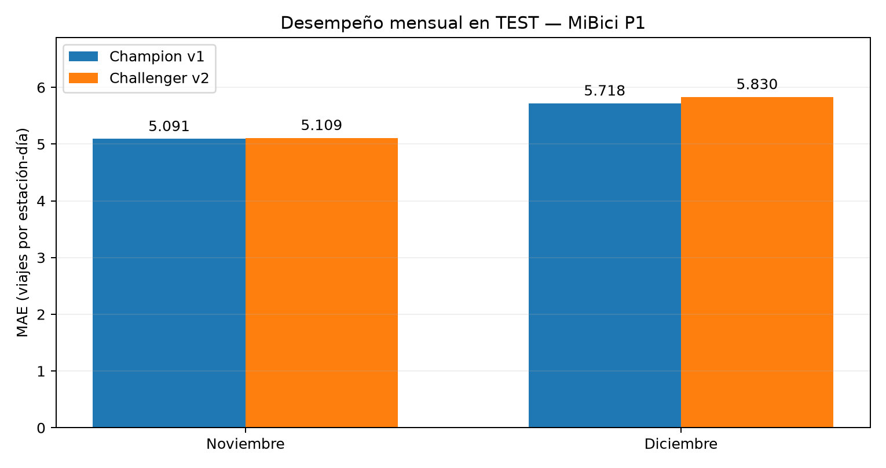
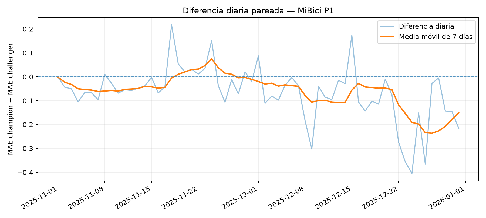
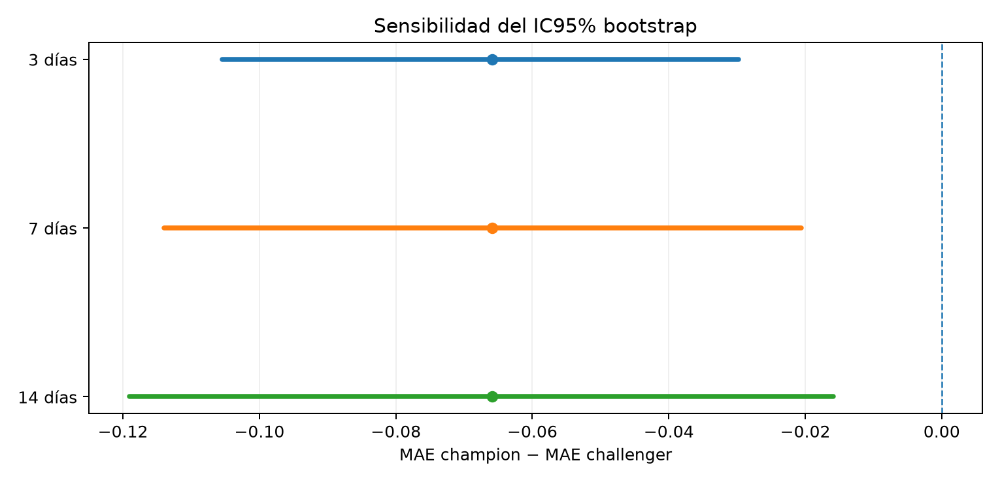

# Evaluación A/B retrospectiva — MiBici P1

## Objetivo

Comparar las versiones registradas de P1 sobre exactamente
las mismas observaciones de noviembre–diciembre de 2025.

Esta prueba es retrospectiva y pareada. No es un experimento
online aleatorizado ni mide impacto causal en producción.

## Versiones

- **Champion v1:** run `371bf2379bfa4a74b8effbe02d2ee3ae`.
- **Challenger v2:** run `31ce19ba37554c7399d20de74a0fb31a`.
- **Versión de datos:** `7aa5e436d887`.
- **Observaciones:** 22,565.
- **Días:** 61.

Ambos modelos utilizan el Pipeline original Poisson.
El challenger incorpora octubre al entrenamiento y mantiene
los hiperparámetros originales.

## Resultados globales

| Métrica | Champion v1 | Challenger v2 |
|---|---:|---:|
| MAE | 5.409786 | 5.475699 |
| RMSE | 9.139358 | 9.266864 |
| WAPE | 0.175258 | 0.177393 |
| R² | 0.923406 | 0.921254 |
| Sesgo | 1.357662 | 1.645940 |

Diferencia MAE (champion menos challenger): **-0.065913**.

Mejora relativa del challenger:
**-1.218%**.

Días con mejor MAE del challenger:
**11 de 61**.

## Resultados mensuales





## Incertidumbre y sensibilidad

Se utiliza bootstrap pareado circular con bloques
temporales, 3,000 réplicas y semilla 42.

La especificación principal utiliza bloques de siete días.
Las otras longitudes constituyen un análisis exploratorio
de sensibilidad y no sustituyen una validación futura.

| Bloque (días) | IC95% inferior | IC95% superior |
|---|---:|---:|
| 3 | -0.105422 | -0.029736 |
| 7 | -0.113995 | -0.020573 |
| 14 | -0.119066 | -0.015921 |



El intervalo representa la diferencia
`MAE champion - MAE challenger`; valores negativos
favorecen al champion.

El bootstrap es aproximado y no elimina todas las posibles
dependencias entre estaciones y periodos.

## Decisión

**Conservar champion v1.**

El criterio predefinido exige mejora global del MAE,
límite inferior del IC95% superior a cero y ausencia
de regresiones mensuales, además de revisión humana.

No se ha cambiado ningún alias en MLflow.

## Reproducibilidad

Desde la raíz del repositorio, con MLflow accesible
en `http://127.0.0.1:5000`:

```bash
./.venv/bin/python -m monitoring.preparar_p1
./.venv/bin/python -m monitoring.comparar_ab_p1
./.venv/bin/python -m monitoring.exportar_evidencias_ab_p1
```

La evaluación consulta el Model Registry y utiliza
el conjunto TEST únicamente para comparación final.
No se deben ajustar hiperparámetros retrospectivamente
en función de estos resultados.

Los CSV incluidos son agregados diarios y mensuales;
no contienen las observaciones individuales originales.
